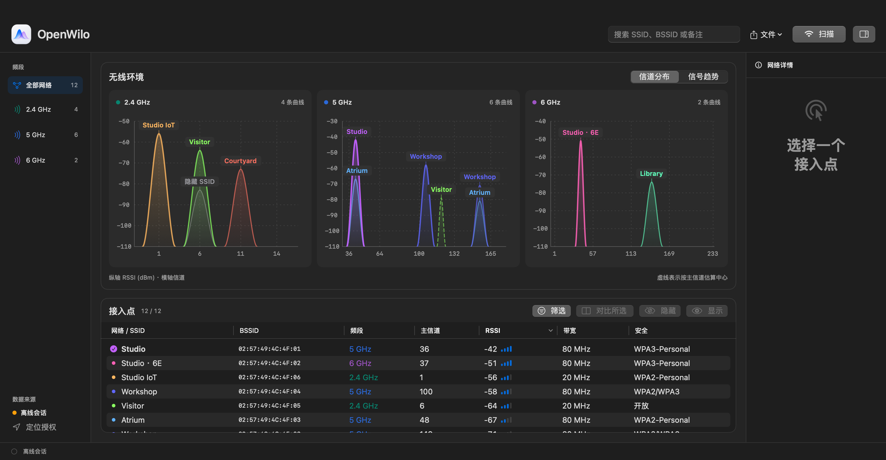
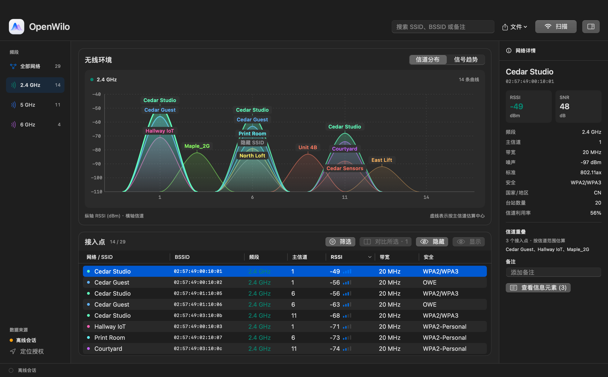
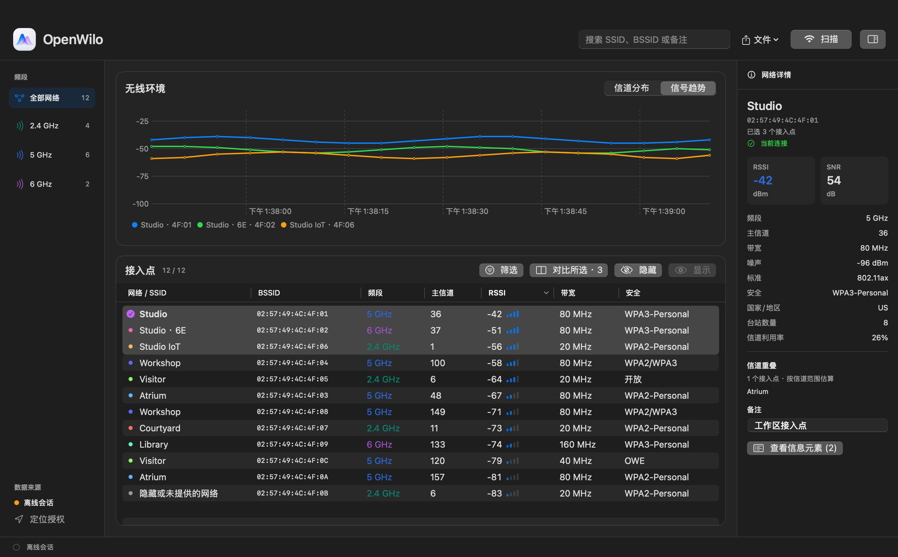

# OpenWilo

**A native Wi-Fi channel analyzer for macOS**

English · [简体中文](README.zh-CN.md)

OpenWilo scans nearby Wi-Fi access points and shows where their channels overlap. Use it to see which networks share spectrum, track signal changes, and inspect the details of your Mac’s current Wi-Fi connection.

## Screenshots

Example views from a fictional scan with 29 access points, including 14 on 2.4 GHz. These screenshots show the Simplified Chinese edition.







## Features

- **Channel charts** for 2.4, 5, and 6 GHz, with adaptive RSSI axes, labels, and consistent colors per SSID. The overview shows the 6 GHz chart when matching results are available.
- **Live scanning and signal history.** Start or stop scanning with one button. OpenWilo waits two seconds after each scan completes before starting the next.
- **Access point inspection.** Search and filter results, hide selected access points from the charts, compare multiple access points, and view decoded fields and raw bytes for supported 802.11 information elements.
- **Current connection details.** See the transmit link rate, active Wi-Fi standard, channel width, signal, noise, and SNR when macOS provides them.
- **Local sessions.** Save and reopen JSON sessions with signal history and notes. Export the filtered list or selection to CSV.

## Download and use

Choose an English (`en`) or Simplified Chinese (`zh-CN`) ZIP for Apple silicon (`arm64`) or Intel (`amd64` / `x86_64`). Both editions require **macOS 14 or later**. Extract the ZIP and open `OpenWilo.app`. The release builds are ad hoc signed and have no Apple notarization. [GitHub Releases](https://github.com/miaostudio2324/OpenWilo/releases/latest)

Each edition displays its own app interface language regardless of your macOS language. macOS-provided controls may use the system language.

Click **Location Access** to let macOS reveal network names and BSSIDs. A successful authorization starts scanning automatically. Click **Scan** to start or **Stop Scan** to stop.

6 GHz results depend on your Mac’s wireless hardware and the data returned by macOS. A dashed curve indicates an estimated channel center. The transmit link rate describes the local Wi-Fi link.

## Privacy

OpenWilo uses CoreWLAN to scan local Wi-Fi. It uses Core Location authorization to access Wi-Fi identifiers and does not request geographic coordinates. Scan results and notes are processed locally. Exported sessions and CSV files may contain nearby network names and BSSIDs.

## Build from source

Install Xcode or Command Line Tools with Swift 6 and run:

```sh
swift test
./scripts/build-app.sh
```

The script builds the Simplified Chinese edition at `dist/OpenWilo.app` for the host architecture. To cross-compile the English edition for Intel on macOS, run:

```sh
./scripts/build-app.sh release "$PWD/dist/en-intel/OpenWilo.app" x86_64 en
```

OpenWilo uses SwiftUI, Swift Charts, and CoreWLAN, with no third-party package dependencies.

## License

See [LICENSE](LICENSE) for the MIT license.
