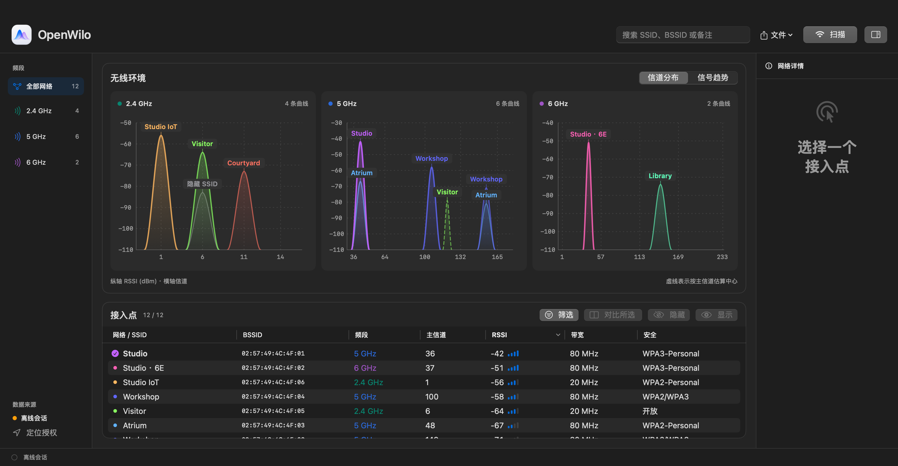
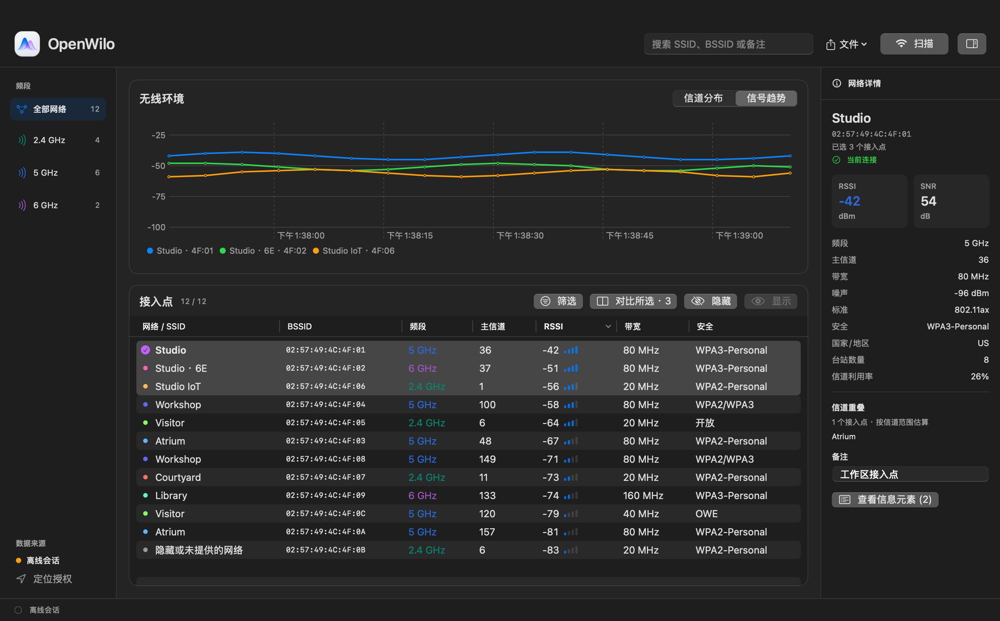

# OpenWilo

**macOS 原生 Wi-Fi 信道分析器**

[English](README.md) · 简体中文

OpenWilo 扫描附近的 Wi-Fi 接入点，用信道图呈现频段重叠情况。你可以观察哪些网络共用频谱、追踪信号变化，并检查 Mac 当前的 Wi-Fi 连接。

## 界面示例

以下截图使用虚构的 Wi-Fi 网络数据。





## 主要功能

- **2.4、5、6 GHz 信道图**。纵轴按 RSSI 自适应，曲线带 SSID 标签，同名网络使用同一种颜色。有匹配结果时，首页会显示 6 GHz 图。
- **连续扫描和信号历史**。一键启停，每轮扫描完成后等待 2 秒再开始下一轮。
- **接入点检查**。支持搜索、筛选、隐藏或显示所选曲线、多选对比，以及查看常见 802.11 信息元素的解码字段与原始字节。
- **当前连接详情**。在 macOS 提供数据时，显示发送链路速率、连接制式、信道带宽、信号、噪声和 SNR。
- **本地会话**。保存或重开含历史采样和备注的 JSON 会话，也可将筛选结果或所选项导出为 CSV。

## 下载与使用

从 [GitHub Releases](https://github.com/miaostudio2324/OpenWilo/releases/latest) 下载适合你 Mac 的 ZIP。Apple 芯片版为 arm64，Intel 版为 amd64（x86_64），均需要 **macOS 14 或更高版本**。解压后打开 `OpenWilo.app`。发布包使用 ad hoc 签名，未经过 Apple 公证。

点击「定位授权」以获取网络名称和 BSSID。授权完成后会自动开始扫描。右上角的「扫描」和「停止扫描」可手动控制启停。

6 GHz 结果取决于 Mac 的无线硬件及 macOS 返回的数据。虚线表示信道中心位置为估算值。发送链路速率反映本地 Wi-Fi 链路的速率。

## 隐私

OpenWilo 通过 CoreWLAN 扫描附近网络。定位授权仅用于读取 Wi-Fi 标识符，应用不请求地理坐标。扫描结果与备注在本机处理，导出的会话或 CSV 可能含有附近网络的 SSID 和 BSSID。

## 从源码构建

安装带 Swift 6 的 Xcode 或 Command Line Tools，然后执行：

```sh
swift test
./scripts/build-app.sh
```

默认构建当前 Mac 架构，产物位于 `dist/OpenWilo.app`。在 macOS 上交叉编译 Intel 版可运行：

```sh
./scripts/build-app.sh release "$PWD/dist/intel/OpenWilo.app" x86_64
```

项目使用 SwiftUI、Swift Charts 和 CoreWLAN，无第三方 Swift 包依赖。

## 许可证

项目采用 [MIT 许可证](LICENSE)。
